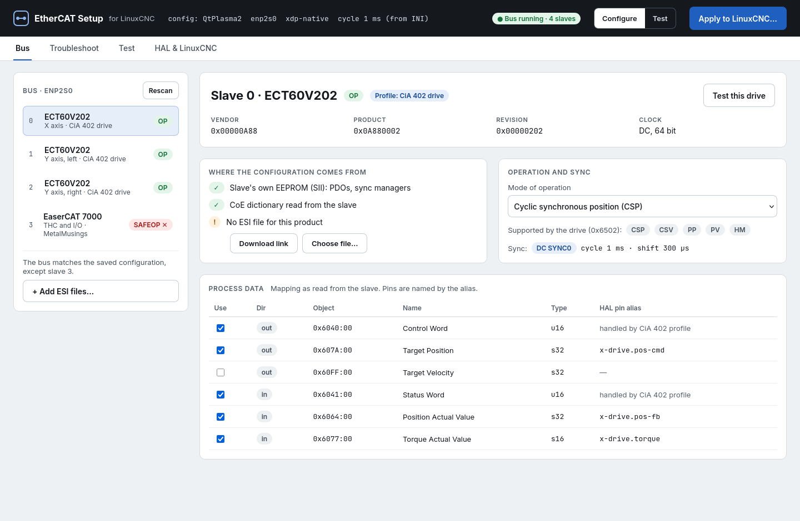
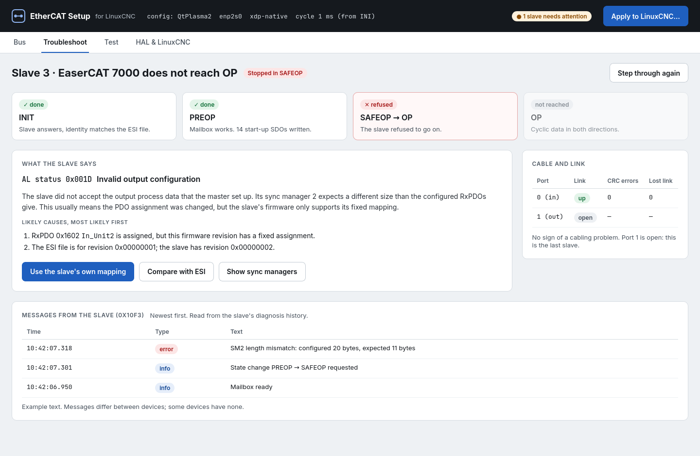
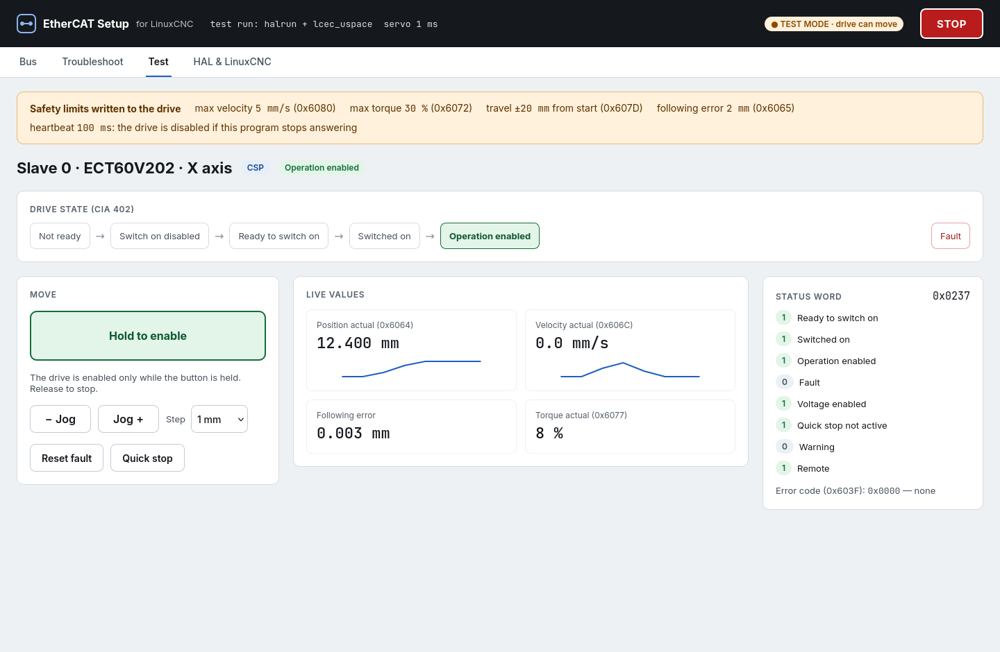
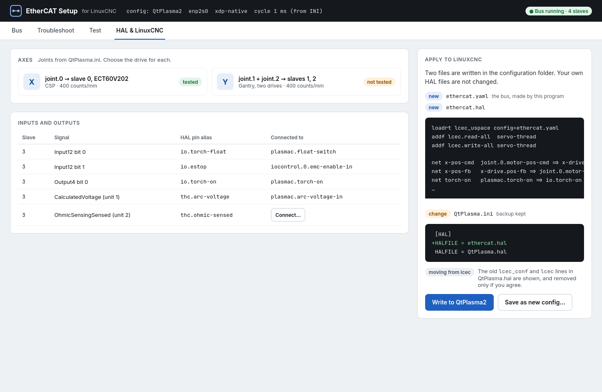

# EtherCAT Setup for LinuxCNC: design draft

Status: **draft for discussion**, 2026-11-08. Nothing here is built yet.
Directions will change as parts are tried on real machines.

## Summary

Today an EtherCAT bus for LinuxCNC is set up by writing an XML file
(`ethercat-conf.xml`) and HAL lines by hand. Many users find this hard to
get right, and when a slave does not work, finding out why takes
knowledge of EtherCAT that most users do not have.

This document proposes:

- **EtherCAT Setup**, an interactive program that shows the slaves on the
  bus, configures them from the slave's own data and its ESI file, helps
  bring up and troubleshoot a slave that does not work, tests it (I/O,
  SDOs, CiA 402 drives, sync modes), connects it to HAL, and writes the
  result into the LinuxCNC configuration;
- a **configuration file written by that program** instead of the
  hand-written XML file, read directly by `lcec_uspace`;
- **device support from data** (ESI, slave data, device profiles)
  instead of one C driver per product.

It is built only for the userspace EtherCAT master (`lcec_uspace`), and in
steps, each of which is useful on its own.



## The problem

What a user has to know today:

| Information | Where | What makes it hard |
|---|---|---|
| Which slaves, position, type name | XML | lcec type names and positions must be known |
| Driver options (`modParam`) | XML | Driver documentation must be read |
| PDO mapping for generic slaves | XML | Indexes, subindexes, bit lengths, sync managers |
| Start-up SDOs | XML | Object dictionary and byte order |
| Distributed clocks (`assignActivate`, `sync0Cycle`, shift) | XML | Values from the ESI file |
| `appTimePeriod` | XML | Must match the servo period in the INI file |
| Connections to HAL | HAL file | Pin names must be looked up with `halcmd show` |

Almost all of this can be read from the slave (SII, CoE object
dictionary, 0x1C12/0x1C13, 0x6502), taken from the ESI file (PDO
alternatives, DC modes, init commands), or taken from the INI file (the
servo period). The difficulty is not the XML syntax but that the user
must know what to write.

Many users already use the `generic` device type instead of the
product-specific drivers, because most slaves only need process data and
start-up settings, not product-specific code. What makes `generic` hard is
writing the mapping by hand.

## Goals

- No hand-written bus configuration. The user picks and confirms; the
  program writes the files.
- Bring up a slave that "does not want to": show where it stops, what it
  reports, the likely cause, and what to do.
- Test a slave before it is used in a machine: read and write I/O, read and
  write SDOs, put a CiA 402 drive into operation and move it safely, try
  sync modes.
- Connect slaves to HAL from the program, with readable pin names.
- Move the result into a LinuxCNC configuration without the user editing
  files.
- Keep existing XML configurations working, and import them.

## Non-goals

- The kernel-mode master. Only the userspace master is supported.
- Machine configuration (axes, kinematics, limits, GUI). That remains the
  job of the LinuxCNC configuration and its tools. EtherCAT Setup only
  connects EtherCAT devices to the joints and signals that exist.
- Replacing HAL. The program writes ordinary HAL lines that the user can
  read.

## Overview

```
                 +-------------------------------------+
                 |        EtherCAT Setup (GUI)         |
                 |          Python + PyQt5             |
                 +-------------------------------------+
                    |                   |             |
     scan, SDOs,    |      test mode    |             |  writes
     diagnosis      |   (HAL pins via   |             |
     (IPC socket)   |   the hal module) |             v
                    v                   v       ethercat.yaml
          +-----------------+   +-------------------+  ethercat.hal
          | ec_master       |   | halrun            |  INI changes
          | (ethercat-      |   |  lcec_uspace      |        |
          |  uspace start)  |   |  config=...       |        v
          +-----------------+   +-------------------+   LinuxCNC:
                    \               /                   loadrt lcec_uspace
                     \             /                    config=ethercat.yaml
                      EtherCAT bus
```

The program uses two parts that already exist, depending on the task:

- **Scan, inspect, SDOs and diagnosis**: a free-running master
  (`ethercat-uspace start`), reached over its IPC socket with the
  `ethercat-uspace` tool's interface. The same works against the master
  inside a running LinuxCNC, for diagnosis while the machine runs.
- **Cyclic tests (I/O, CiA 402, DC)**: `halrun` with `lcec_uspace`, the
  generated configuration and a servo thread, without motion. The program
  reads and writes HAL pins through LinuxCNC's Python `hal` module, as
  qtvcp does. What is tested is the same code that runs the machine.

A master built into the program itself would be a third way to the bus,
with its own behaviour to maintain. It is only worth adding if something
turns out to be impossible through the two above.

## The configuration file

`ethercat.yaml` in the machine configuration's folder (format to be
settled; YAML is the working assumption). It is written by EtherCAT Setup
and is not meant to be edited by hand, but it stays a readable text file:
it can be kept under version control, compared, and posted to the forum
when asking for help, and LinuxCNC can start without EtherCAT Setup
installed.

It holds, per slave: position and identity (vendor, product, revision,
serial if the slave has one), the profile and options, the PDO selection,
start-up SDOs, the sync mode, pin aliases and scaling. The servo period is
not repeated; it comes from the INI file.

`lcec_uspace` reads the file itself:

```
loadrt lcec_uspace config=ethercat.yaml
```

This removes `loadusr -W lcec_conf ethercat-conf.xml`, and with it the
need for `lcec_conf` and `lcec_uspace.so` to agree on a shared-memory
layout. Existing XML files keep working and can be imported.

**Pin aliases**: `lcec_uspace` creates pins with names chosen in the
program, such as `x-drive.pos-fb`, instead of `lcec.0.0.actual-position`,
so that HAL files are readable.

## Device support from data

Today's drivers do three different things, which should be handled
differently:

| What a driver does | Examples | Proposal |
|---|---|---|
| Data: PDO mapping, start-up SDOs, DC mode | most Beckhoff drivers | Read from the ESI file and the slave; no code |
| Pins: name, type, direction, scaling | `din-0`, `aout-1-scale` | Made from the PDO entries: type from the ESI data type, name from the ESI or the user's alias |
| Behaviour: logic in every cycle | CiA 402 state machine, encoder overflow, latch, SoE | **Profiles** (below) |

**Profiles** follow standards, not products:

- **CiA 402 (ETG.6010)** for drives: one profile that reads 0x6502 and the
  mapping covers most drives.
- **Modular Device Profile (ETG.5001)**, which Beckhoff and many others
  follow: inputs in 0x6000, outputs in 0x7000, settings in 0x8000. Digital
  I/O, analog I/O and encoder profiles build on this layout.
- **Quirks as data**: a small table per vendor and product for devices that
  need something special (an SDO in PREOP, a known SII error).
- **Existing C drivers as a fallback** for what does not fit (for example
  SoE drives or FSoE) until it can be replaced.

**Data sources**, in order: the slave itself (SII, CoE dictionary), which
says what it is; the ESI file, which says what is possible and what it
means; and the user's choices. Without an ESI file the slave's own data
often goes a long way; with one, names are better and the alternatives
are known.

**ESI files**: many vendors do not allow redistribution, so the program
uses files the user has downloaded (a folder, or one file per device),
with links to where to download them. ESI files vary in quality, one file
may cover several revisions, and modular devices (bus couplers with
slots) need to know which modules are fitted.

**Later**: user comments per device ("works in CSP, needs 0x2010 set"),
shown next to the device, and a shared list of download links.

## Bringing up and troubleshooting a slave

Much of what is needed exists in the master but is shown in a way only
experts understand. The program shows it in plain language:

- **State by state**: INIT → PREOP → SAFEOP → OP, one step at a time.
  Where it stops, the AL status code is explained with its likely causes
  and actions, for example 0x001D/0x001E (process data mapping), 0x0035
  (cycle time), 0x002C/0x0032 (DC sync).
- **The slave's own messages**: the diagnosis history 0x10F3 (ETG.1020),
  where many slaves say exactly what they do not accept.
- **CiA 402**: the status word and error code 0x603F in plain language,
  and what is missing to reach "Operation enabled".
- **Cable and link**: error counters per port (CRC errors, lost link),
  which point at bad cables and connectors.
- **Comparison**: the bus against the configuration, and the slave against
  the ESI file, so a wrong revision or position shows.



## Test mode and safety

Test mode runs `lcec_uspace` in `halrun` as described above, so I/O,
SDOs, CiA 402 drives and sync modes are tested with the same code as in
the machine. LinuxCNC must not run at the same time; diagnosis without
motion also works against a running LinuxCNC.

Moving a CiA 402 drive from a test program needs care:

- **No motion without a deliberate act**: the drive stays in "Switched
  on" until the user enables it, with a hold-to-enable button.
- **Heartbeat**: the GUI writes a heartbeat to a HAL pin; if it stops, for
  example because the GUI hangs, the HAL thread disables the drive.
  Safety must not depend on the GUI being alive.
- **Limits written to the drive**: low maximum velocity and torque
  (0x6080, 0x6072), software position limits (0x607D) and a tight
  following-error window (0x6065), set in the drive, not only in the
  program.
- **Careful motion**: jog in small steps or at low velocity, not free
  positioning.
- **Emergency stop**: if the machine's E-stop is wired through EtherCAT
  I/O, test mode can use it.



## Integration with LinuxCNC

The program writes, after showing the change and keeping a backup:

```ini
[ETHERCAT]
CONFIG = ethercat.yaml

[HAL]
HALFILE = ethercat.hal      ; before the user's own HAL files
HALFILE = my-machine.hal
```

`ethercat.hal` holds `loadrt lcec_uspace config=...`, the `addf` lines and
the connections made in the program. The user's own HAL files are not
changed. When an existing `lcec` configuration is moved over, the old
`lcec_conf` and `lcec` lines in the user's HAL file are shown, and removed
only if the user agrees.

At start, `lcec_uspace` compares the bus with the file and stops with a
clear message if they differ, such as "slave 2 is an EL2008, the
configuration expects an EL1008; run EtherCAT Setup".



## Technology

- **Python and PyQt5**: present in every LinuxCNC installation, known in
  the community, and LinuxCNC's `hal` module is available.
- **EtherCAT access** through the userspace master's IPC socket and HAL.
  No new C bindings at first.
- **`lcec_uspace`** gains reading of `ethercat.yaml`, pin aliases and
  profile-based device support.

## Open questions

- **Identifying slaves**: some slaves report serial number 0 (the ECT60
  drives on the test machine do), so slaves can only be told apart by
  position and type. Swapped drives are not noticed automatically; test
  mode can help (jog X and see which motor moves).
- **Scaling**: in the configuration file (lcec scales, test mode shows
  mm), or in HAL as today?
- **File format**: YAML, or something else?
- **INI keys**: names and placement of `[ETHERCAT]` settings.
- **Joints and gantries**: what the program reads from the INI file, and
  where the line to machine configuration tools goes.
- **Modular devices**: how slots and modules are detected and chosen.
- **ESI files**: licensing, finding the right file and revision.
- **Upstream**: how this can live next to the XML-based setup so that it
  can be taken upstream.

## Plan

Each step is useful on its own; the order may change as parts are tried.

1. **Prototype the core idea**: read ESI files, SII and the CoE dictionary
   (Python, no GUI) and propose PDO mapping, DC mode and pins for the
   slaves on a real bus. Compare with a hand-written XML configuration
   known to work.
2. **Data model and file**: `ethercat.yaml`, `lcec_uspace config=...`,
   pin aliases, import of XML files.
3. **Generator without GUI**: scan, match profiles, write the file (a
   successor to `lcec_configgen`).
4. **Test mode and troubleshooting**: the GUI on top of `halrun` and the
   master's IPC.
5. **HAL and LinuxCNC integration**: `ethercat.hal`, INI changes, the start
   check.
6. **Later**: ESI download links, user comments per device.

## Mockups

The screens in this document are mockups without function, made to show
the idea. Slave identities and PDOs are read from the test machine's bus;
messages, limits and values are examples.
